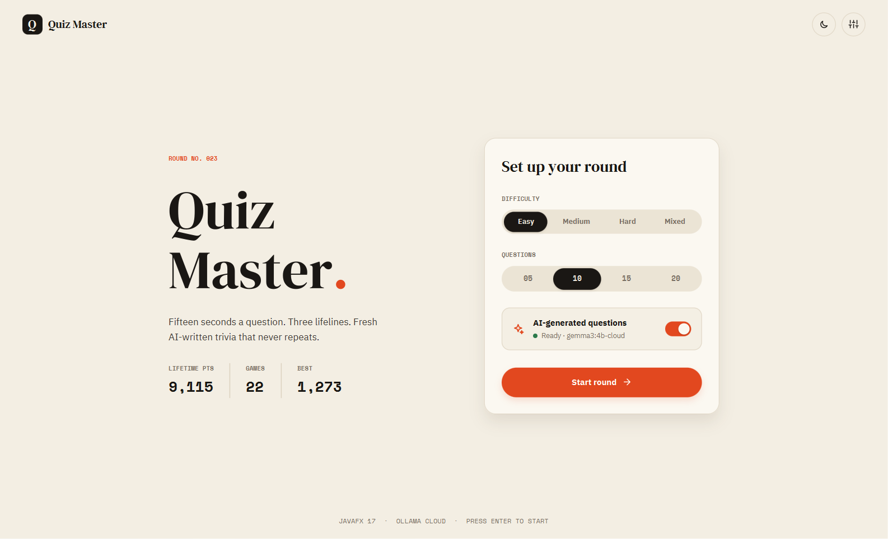

# 🧠 QuizMaster

A modern, professionally designed quiz application built with **JavaFX 17** following the **MVC architecture pattern**. Features an editorial, quiz-show-inspired interface with light and dark themes, smooth animations, AI-powered question generation via **Ollama Cloud API**, and a sophisticated points-and-trophy progression system.



---

## ✨ Features

### 🎮 Gameplay
- **AI-Generated Questions** — Connect to the [Ollama Cloud API](https://ollama.com) to generate fresh, unique quiz questions using `gemma3:4b-cloud` with automatic model fallback
- **Smart Difficulty System** — EASY, MEDIUM, HARD, and RANDOM modes with detailed AI prompt engineering so questions actually match the selected difficulty
- **Custom Question Count** — Choose exactly how many questions you want: 5, 10, 15, or 20
- **15-Second Timer** — Visual countdown with urgency cues when time is running low
- **Timed Questions** — Earn bonus points for answering quickly

### 🎯 Lifeline System
- **🎯 50:50** — Removes 2 wrong options, leaving only the correct answer and 1 decoy (1 use per quiz)
- **⏩ Skip** — Skip the current question without any penalty or score loss (1 use per quiz)
- **⏰ +10s** — Adds 10 extra seconds to the countdown timer (1 use per quiz)
- Lifelines sit under the answers as outlined chips (keys **F**, **S**, **T**) and fade once used

### 📊 Scoring & Progression
- **Advanced Points System** — Base points by difficulty (Easy: 100, Medium: 200, Hard: 300) + time bonus + streak multiplier
- **Combo Streaks** — Maintain consecutive correct answers for bonus points and on-screen combo graphics
- **Trophies** — 🏆 Champion, 🥇 Gold, 🥈 Silver, 🥉 Bronze, ⭐ Participant based on accuracy
- **Lifetime Stats** — Persistent tracking of total points, games played, and best score across sessions

### 🧠 AI Memory System
- **No Repeat Questions** — Persistent memory stores up to 80 past questions and prevents the AI from regenerating them
- **Cross-Session Memory** — Memory survives app restarts and "Play Again" cycles
- **Prompt Injection** — Past question snippets are injected into AI prompts to avoid similar topics

### 🎨 UI & Design
- **Two Themes** — *Paper* (warm cream & ink) and *Studio* (dark), both driven by shared CSS colour tokens; toggle from the top bar
- **Bundled Typography** — DM Serif Display headlines, Space Mono scoreboards, IBM Plex Sans body text
- **Countdown Ring** — Smooth circular timer that turns red in the last five seconds
- **Keyboard Play** — Answer with **A–D** or **1–4**
- **Crisp Vector Icons** — SVG-path icons instead of emoji (which JavaFX can't render reliably)
- **Animated Splash Screen** — Monogram pop, wordmark rise and an accent rule that draws itself
- **Screen Shake** — Heavy shake effect on wrong answers for high-stakes feel
- **Floating Points** — +Points animation on correct answers
- **Wrong Answer Review** — See exactly which questions you got wrong at the quiz end, with your answer vs. the correct one

### 🧩 Technical
- **30+ Built-in Fallback Questions** — Curated trivia for offline play when AI is unavailable
- **Robust JSON Parser** — 3-strategy extraction handles malformed AI responses gracefully
- **Topic Diversity Engine** — Each parallel AI request gets a unique topic category (science, history, geography, etc.) to prevent duplicate questions
- **Post-Generation Deduplication** — Keyword overlap algorithm removes similar questions even if topics overlap
- **Option Prefix Deduplication** — Strips AI-generated "A.", "B)" prefixes to prevent double-labels
- **Parallel API Calls** — All questions generated simultaneously across thread pool for speed
- **Auto Model Fallback** — If primary model fails, automatically tries `ministral-3:3b-cloud`, `gemini-3-flash-preview:cloud`, `qwen3.5:cloud`, `gemma4:31b-cloud`

---

## 🛠️ Tech Stack

| Component       | Technology                     |
|-----------------|-------------------------------|
| Language        | Java 17                        |
| UI Framework    | JavaFX 17.0.6                  |
| Build Tool      | Apache Maven 3.9.6             |
| JSON Parsing    | Gson 2.10.1                    |
| AI Integration  | Ollama Cloud API (Bearer Auth) |
| Primary Model   | `gemma3:4b-cloud` (4B params)  |
| Architecture    | MVC (Model-View-Controller)    |

---

## 📁 Project Structure

```
QuizMaster/
├── pom.xml                              # Maven build configuration
├── README.md                            # This file
├── HOW_IT_WORKS.md                      # Detailed developer/architecture guide
├── apache-maven-3.9.6/                  # Bundled Maven (no install needed)
└── src/main/
    ├── java/com/quiz/
    │   ├── Main.java                    # Application entry point
    │   ├── controller/
    │   │   └── AppController.java       # Central router & scene orchestrator
    │   ├── model/
    │   │   ├── Difficulty.java          # EASY, MEDIUM, HARD, RANDOM enum
    │   │   ├── Question.java            # Question data model
    │   │   └── QuizSession.java         # Active quiz logic, points, wrong answer tracking
    │   ├── ui/
    │   │   ├── SplashView.java          # Animated startup screen
    │   │   ├── SetupView.java           # First-run API key setup
    │   │   ├── StartView.java           # Home/Menu screen with difficulty selector
    │   │   ├── SettingsView.java        # Theme & API config panel
    │   │   ├── QuizView.java            # Gameplay interface with timer & animations
    │   │   └── ResultView.java          # Score, trophies & wrong answer review
    │   └── util/
    │       ├── AIQuestionGenerator.java # Ollama Cloud API, prompt engineering, memory system
    │       ├── AnimationHelper.java     # Reusable JavaFX animation utilities
    │       ├── ConfigManager.java       # Local properties file persistence
    │       └── DataLoader.java          # JSON parsing for built-in questions
    └── resources/
        ├── questions.json               # 30+ built-in fallback trivia questions
        ├── styles.css                   # Design tokens + light "Paper" theme
        └── dark-mode.css                # Dark "Studio" theme (token overrides)
```

---

## 🚀 How to Run

### Prerequisites
- **Java 17** or higher installed (`JAVA_HOME` configured)
- (Optional) **Ollama API key** from [ollama.com/settings/keys](https://ollama.com/settings/keys) for AI questions

### Launch the app

```bash
# Using the bundled Maven (recommended):
.\apache-maven-3.9.6\bin\mvn javafx:run

# Or with system Maven (if installed):
mvn javafx:run
```

---

## 🤖 AI Question Generation

QuizMaster uses the Ollama Cloud API to generate unique trivia questions in real-time.

### Setup
1. **Get an API key**: Visit [ollama.com/settings/keys](https://ollama.com/settings/keys)
2. **Paste it** on the first-run setup screen, or later under **Settings** (the sliders icon, top right)
3. Press **Test key** — a key that works is saved immediately
4. Pick a difficulty and question count, leave **AI-generated questions** on, and press **Start round**

### Where the API key is stored
The key is saved once and reused on every launch. It lives **outside the project**, so it can never be committed to Git:

| OS | Path |
|----|------|
| Windows | `C:\Users\<you>\.quizmaster\config.properties` |
| macOS / Linux | `~/.quizmaster/config.properties` |

It's stored as plain text under `ollama.apikey`. Settings → **Open folder** jumps straight there.
Alternatively, set the `OLLAMA_API_KEY` environment variable — it overrides the saved key.

### Difficulty System
The AI receives detailed prompt instructions per difficulty:

| Difficulty | Target Audience | Example Topics | Option Design |
|-----------|----------------|---------------|--------------|
| **EASY** | A 10-year-old would know | Capitals, planets, famous landmarks, colors | Wrong options are clearly wrong |
| **MEDIUM** | Educated adults | Historical dates, scientific concepts, geography details | Wrong options are plausible |
| **HARD** | Trivia experts only | Obscure facts, niche geography, technical terms | All 4 options seem equally likely |
| **RANDOM** | Mixed | Each question randomly picks EASY/MEDIUM/HARD | Varies per question |

### Reliability
- **Primary model**: `gemma3:4b-cloud` (fast, reliable)
- **Auto fallback**: If primary fails, tries `ministral-3:3b-cloud` → `gemini-3-flash-preview:cloud` → `qwen3.5:cloud` → `gemma4:31b-cloud`
- **Over-provisioning**: Requests 7 questions, returns 5 — compensates for occasional parse failures
- **Offline fallback**: If all AI fails, built-in questions from `questions.json` are used

---

## 🏗️ Architecture (MVC)

```
┌─────────────────────────────────────────────┐
│                   View Layer                 │
│   SplashView · SetupView · StartView        │
│   QuizView · ResultView · SettingsView       │
│   (UI layout, styling, user interactions)    │
└──────────────────────┬──────────────────────┘
                       │
                       ▼
┌─────────────────────────────────────────────┐
│              Controller Layer                │
│              AppController                   │
│   (screen navigation, quiz flow, AI calls)   │
└──────────────────────┬──────────────────────┘
                       │
                       ▼
┌─────────────────────────────────────────────┐
│                Model Layer                   │
│   Question · QuizSession · Difficulty        │
│   (data models, session state, scoring)      │
└──────────────────────┬──────────────────────┘
                       │
                       ▼
┌─────────────────────────────────────────────┐
│              Utility Layer                   │
│   AIQuestionGenerator · ConfigManager        │
│   AnimationHelper · DataLoader               │
│   (AI, persistence, animations, data)        │
└─────────────────────────────────────────────┘
```

---

## 📄 License

This project is for educational purposes.
